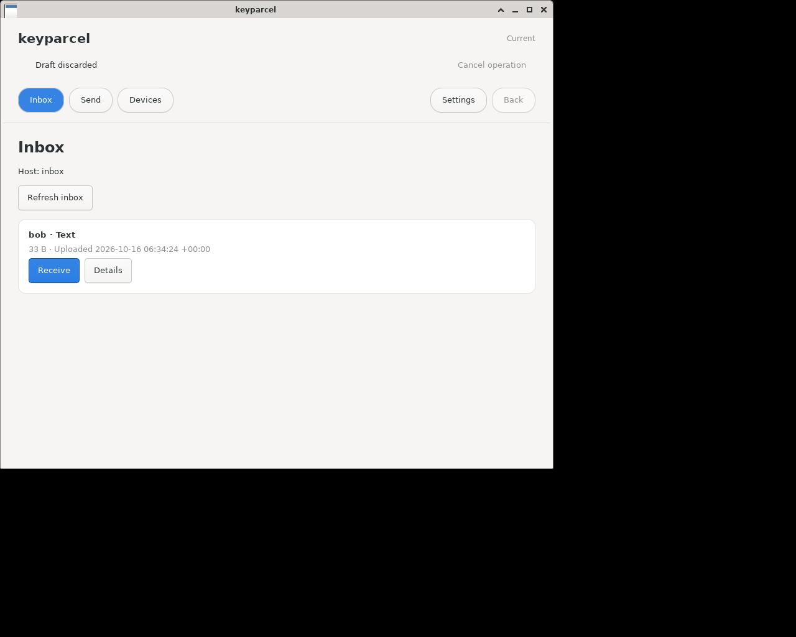
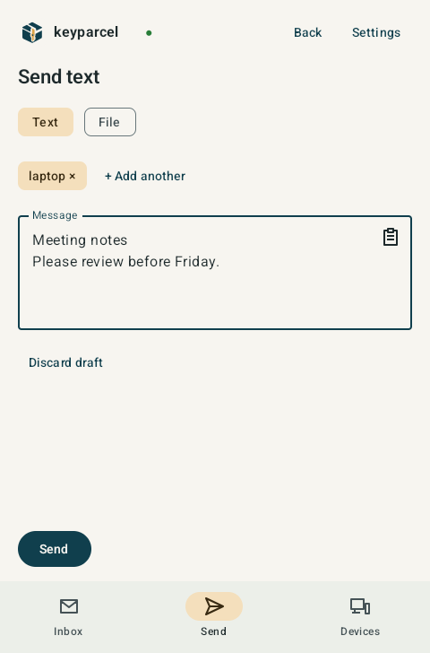

<picture>
  <source media="(prefers-color-scheme: dark)" srcset="assets/branding/logo-dark.svg">
  
</picture>

[](https://github.com/keyparcel/keyparcel/actions/workflows/ci.yml)
[](LICENSE)

Share text and files between your devices through your own SSH server.

- **Your infrastructure:** an SSH account you control; no third-party relay or extra
  server software.
- **Across networks:** no shared LAN required, just an SSH server you can reach.
- **Explicit sharing:** choose what to send and who receives it. Your clipboard isn’t
  continuously monitored or synchronized.
- **Private parcels:** content and metadata, including original filenames, are encrypted
  before reaching the server.
- **Simple clients:** Android, Linux desktop and CLI.

| Linux desktop | Android |
| :---: | :---: |
| [](desktop/client/docs/gallery/inbox.png) | [](android/client/docs/gallery/send.png) |
| Receive text and files | Choose recipients and compose a message |

## How it works

- Your devices connect to the **same user account** on your SSH server, using it as an
  inbox for end-to-end encrypted parcels.
- Each parcel contains text—such as clipboard content—or a single file.
- Parcels are stored under `~/.local/share/keyparcel` **on the server** by default.
- [age](https://age-encryption.org/) encrypts parcels for recipients’ SSH public keys;
  the sender’s SSH key signs them.
- Parcels appear on the server as `<random-id>.age`. The server can observe encrypted
  sizes, timing and recipient inboxes.
- Only the clients need keyparcel installed. The server needs ordinary SSH/SFTP.

## Quick start

With Go, Make and OpenSSH installed, and a dedicated device key **already enrolled**
on an SSH/SFTP server reachable as `parcel-vps`:

```sh
make build
./bin/keyparcel setup --host parcel-vps --identity ~/.ssh/keyparcel --default
./bin/keyparcel send --to self --text 'Hello from keyparcel'
./bin/keyparcel inbox
./bin/keyparcel receive <transfer-id> --stdout
```

Replace `<transfer-id>` with the ID shown by `inbox`. `setup` saves local settings;
it does not enroll the key on your server. Check the server fingerprint when
connecting. To exchange with another device, enroll it too and approve each
other's fingerprints before sending. See [installation and enrollment](docs/installation.md).

GUI clients keep received transfers until you explicitly remove them. CLI receive
removes the recipient's remote copy after successful delivery unless you use
`--keep`. See [usage](docs/usage.md) for saving, copying and deletion behavior.

## Clients

| Client | What it does |
| --- | --- |
| [Android](android/client/README.md) | Text and files, system document pickers, device approval and automatic inbox updates while open |
| [Linux desktop](desktop/client/README.md) | GTK interface for text and files, shared CLI settings, device approval and automatic inbox updates |
| [CLI](docs/usage.md) | Scriptable send/receive, multiple hosts, clipboard copying, inbox watch and Bash completion |

The CLI is exercised on Linux; limited native Intel macOS validation also covers
its clipboard support. Android runtime tests use hosted x86_64 emulators; ARM64
builds are checked statically. RC5 was also manually tested with GTK on Linux and
on a physical ARM64 Android device. Linux DEB/RPM/archive and Android builds can be
made from source. Signed prerelease candidates remain unpublished; public release
downloads are not yet available. This is development software.

## Limitations

- **Private-key access:** CLI/GTK require a private-key file; Android manages its own
  software key. The same SSH identity authenticates the connection and decrypts
  parcels. Agent-only and hardware-backed SSH identities are unsupported by
  [age's SSH-key encryption](https://github.com/FiloSottile/age#ssh-keys).
- **Unencrypted keys:** passphrase-protected private keys are not supported yet.
- **No automatic server cleanup:** unreceived parcels remain until deleted.
  Interrupted uploads can leave encrypted temporary files. The server never sees
  plaintext parcel contents.
- **No read receipts:** a successful send confirms upload, not that the recipient
  opened the parcel.

## Documentation

- [Installation and enrollment](docs/installation.md)
- [CLI usage](docs/usage.md), [Android guide](android/client/README.md), [Linux desktop guide](desktop/client/README.md)
- Screenshots: [Linux](desktop/client/docs/gallery/README.md) · [Android](android/client/docs/gallery/README.md)
- [Private security reporting, security model and identity loss](SECURITY.md)
- [Development, tests and local smoke environments](docs/development.md)
- [Package format](PROTOCOL.md)

## License and contributions

Copyright 2026 keyparcel contributors. Licensed under [Apache-2.0](LICENSE),
with [third-party notices](THIRD_PARTY_NOTICES.txt) preserved.
See [Contributing](CONTRIBUTING.md) for development guidance.
