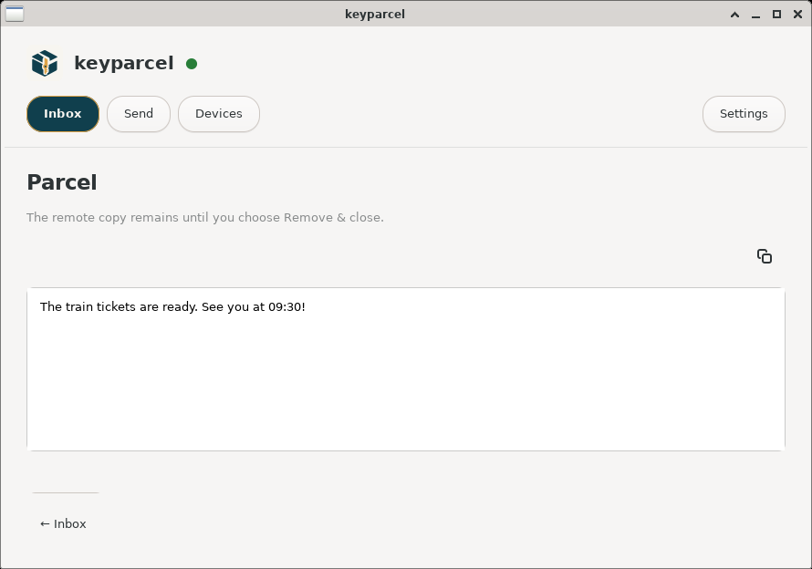
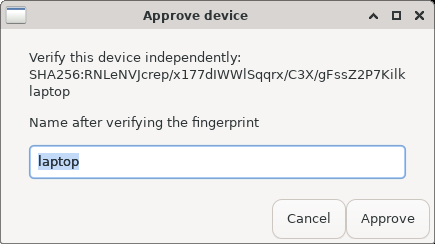

# keyparcel on Linux

Current GTK screens captured from an isolated native X11 fixture with real
text and file transfers. Names, messages and fingerprints are disposable example
data. Images retain the native window frame without the surrounding desktop.

## Inbox

## Received text

## Device approval

[User guide](../../README.md) · [Builds and tests](../../DEVELOPMENT.md)
